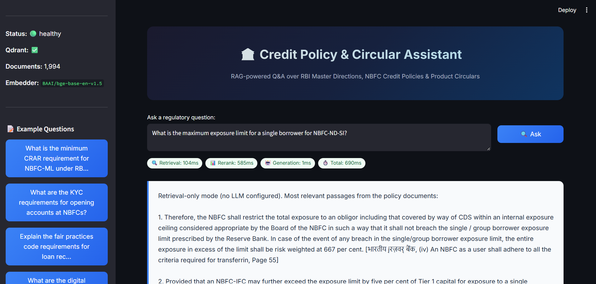

# 🏦 Credit Policy & Circular Assistant

> **A Retrieval-Augmented Generation (RAG) system for question-answering over RBI Master Directions, NBFC Credit Policies, and Product Circulars.**

This project explores and benchmarks multiple document chunking strategies within a production-grade RAG pipeline, evaluating their impact on retrieval quality, answer faithfulness, abstention behaviour, and end-to-end latency.

---

## 📌 Table of Contents

- [Demo](#-demo)
- [Motivation](#-motivation)
- [Research Questions](#-research-questions)
- [System Architecture](#-system-architecture)
- [Chunking Strategies](#-chunking-strategies-compared)
- [Evaluation Methodology](#-evaluation-methodology)
- [Benchmark Results](#-benchmark-results)
- [Tech Stack](#-tech-stack)
- [Project Structure](#-project-structure)
- [Getting Started](#-getting-started)
- [Usage](#-usage)
- [Future Work](#-future-work)
- [Acknowledgements](#-acknowledgements)

---

## 🎥 Demo

<p align="center">
  
</p>

### Sample Query & Response

**Question:** *"What is the minimum CRAR requirement for NBFC-ML under RBI directions?"*

**Answer (generated by the system):**
> Every NBFC-ML shall maintain a minimum Capital to Risk-weighted Assets Ratio (CRAR) of 15%, with Tier-I capital not less than 10%. NBFCs primarily engaged in lending against gold jewellery shall maintain a minimum CRAR of 12%.
>
> *📚 Citation: Master Direction – Non-Banking Financial Company – Systemically Important Non-Deposit taking Company (Reserve Bank) Directions, 2016 — Chapter IV, Section 16 — Page 23* ✓ Verified

---

## 💡 Motivation

Financial regulatory documents — such as RBI Master Directions and NBFC circulars — are lengthy, highly structured, and frequently cross-referenced. Compliance teams spend significant time manually searching through hundreds of pages to answer specific policy questions.

This project investigates whether a RAG-based assistant can reliably answer such questions by:
1. Parsing and chunking regulatory PDFs using different strategies.
2. Retrieving relevant passages via hybrid (dense + sparse) search.
3. Generating grounded, citation-backed answers using an LLM.
4. **Abstaining** when the retrieved context is insufficient — a critical requirement for high-stakes regulatory domains where hallucinations are unacceptable.

---

## 🔬 Research Questions

| # | Question |
|---|---------|
| RQ1 | How does the chunking strategy (fixed-size vs. recursive-overlap vs. structural) affect retrieval recall and ranking quality (Recall@5, MRR)? |
| RQ2 | Does structure-aware chunking improve answer faithfulness by preserving section boundaries and metadata? |
| RQ3 | Can a reranker-score-based abstention mechanism reliably detect unanswerable queries, and how does its precision/recall vary across chunking strategies? |
| RQ4 | What are the latency trade-offs introduced by cross-encoder reranking in a real-time Q&A setting? |

---

## 🏗 System Architecture

```
┌─────────────────────────────────────────────────────────────────────┐
│                         User Interface                              │
│                    (Streamlit — port 8501)                           │
└──────────────────────────┬──────────────────────────────────────────┘
                           │  HTTP (httpx)
┌──────────────────────────▼──────────────────────────────────────────┐
│                       FastAPI Backend (port 8000)                    │
│                                                                     │
│  ┌──────────┐  ┌───────────────┐  ┌──────────┐  ┌───────────────┐  │
│  │  Hybrid   │  │   Reranker    │  │ Abstain  │  │   Generator   │  │
│  │ Retriever │──▶ (Cross-Enc.) │──▶  Gate    │──▶  (GPT-4o /    │  │
│  │ (Dense +  │  │  ms-marco-   │  │          │  │   Gemini)     │  │
│  │  BM25+RRF)│  │  MiniLM-L6   │  │          │  │              │  │
│  └─────┬─────┘  └──────────────┘  └──────────┘  └──────┬────────┘  │
│        │                                                │           │
│        │                                    ┌───────────▼────────┐  │
│        │                                    │ Citation Verifier  │  │
│        │                                    └────────────────────┘  │
└────────┼────────────────────────────────────────────────────────────┘
         │  Vector + Payload Search
┌────────▼────────┐
│   Qdrant        │
│ (Vector DB)     │
│  port 6333      │
└─────────────────┘
```

### Pipeline Flow

1. **Ingestion** — PDFs are parsed (PyMuPDF + pdfplumber), metadata is extracted (document title, section hierarchy, page numbers), and text is split into chunks using one of three strategies.
2. **Embedding** — Each chunk is embedded using `BAAI/bge-base-en-v1.5` (768-dim) and stored in Qdrant alongside rich metadata payloads.
3. **Retrieval** — A hybrid retriever fuses dense cosine-similarity search with BM25 sparse search using **Reciprocal Rank Fusion (RRF)**.
4. **Reranking** — Retrieved candidates are rescored with a `cross-encoder/ms-marco-MiniLM-L-6-v2` cross-encoder.
5. **Abstention Gate** — If the top reranked score falls below a configurable threshold (default `0.35`), the system abstains rather than hallucinate.
6. **Generation** — Surviving queries are answered by an LLM (GPT-4o or Gemini 1.5 Pro) prompted with the top-K reranked passages.
7. **Citation Verification** — Generated citations are verified against the retrieved chunks to flag ungrounded references.

---

## 📐 Chunking Strategies Compared

| Strategy | Description | Key Parameters |
|----------|-------------|----------------|
| **`fixed_512`** | Naïve fixed-window chunking. Splits text into 512-token windows with no overlap. Fast but ignores document structure. | `chunk_size = 512 tokens` |
| **`recursive_overlap`** | Recursive character-based splitting with overlap. Uses LangChain's `RecursiveCharacterTextSplitter` to split on paragraph → sentence → word boundaries. | `chunk_size = 512 tokens`, `overlap = 128 tokens` |
| **`structural`** | Structure-aware chunking that respects section headers, sub-section boundaries, and table/list blocks. Preserves the document's inherent hierarchy in chunk metadata. | `max_chunk_size = 1024 tokens` |

---

## 📊 Evaluation Methodology

### Gold Evaluation Set
A curated set of question-answer pairs (stored in `src/evaluation/gold_set.json`) covering four difficulty categories:

| Category | Description |
|----------|-------------|
| `easy_lookup` | Single-fact questions answerable from one chunk |
| `multi_hop` | Questions requiring synthesis across multiple sections |
| `inference` | Questions needing reasoning over retrieved content |
| `unanswerable` | Out-of-scope questions the system should abstain on |

### Metrics

| Metric | What It Measures |
|--------|-----------------|
| **Recall@5** | Fraction of queries where the relevant document appears in the top 5 retrieved results |
| **MRR** (Mean Reciprocal Rank) | Average of `1/rank` of the first relevant result — rewards higher placement |
| **Faithfulness** | Fraction of claims in the generated answer that are grounded in retrieved context (LLM-as-judge) |
| **Abstention Precision** | Of all abstentions, how many were correct (query was truly unanswerable) |
| **Abstention Recall** | Of all unanswerable queries, how many were correctly abstained on |
| **p50 / p95 Latency** | Median and 95th-percentile end-to-end response time |

---

## 📈 Benchmark Results

| Strategy | Recall@5 | MRR | Faithfulness | Abstention P | Abstention R | p50 Latency | p95 Latency |
|----------|----------|-----|-------------|-------------|-------------|-------------|-------------|
| `fixed_512` | 0.7717 | 0.8192 | 0.5787 | 0.36 | 0.60 | 638ms | 680ms |
| `recursive_overlap` | 0.8067 | 0.8120 | 0.6323 | 0.33 | 0.60 | 646ms | 696ms |
| **`structural`** | **0.8133** | **0.8283** | **0.6679** | **0.39** | 0.60 | 517ms | 596ms |
| `structural_norerank` | 0.8200 | 0.8270 | 0.6721 | 0.00 | 0.00 | 51ms | 93ms |

### Key Findings

1. **Structural chunking outperforms** fixed and recursive strategies on Recall@5, MRR, and Faithfulness — confirming that preserving document hierarchy yields better retrieval boundaries.
2. **Reranking is essential for abstention.** The `structural_norerank` variant shows competitive retrieval scores but completely loses the ability to abstain (Precision = 0, Recall = 0), since there is no cross-encoder confidence score to threshold on.
3. **Latency cost of reranking is modest.** The cross-encoder adds ~450–550ms, which is acceptable for an interactive Q&A tool but notable for batch workloads.
4. **Faithfulness improves with chunk quality.** Structural chunks carry richer section-level metadata, helping the LLM ground its answers more precisely.

---

## 🛠 Tech Stack

| Component | Technology |
|-----------|-----------|
| **Language** | Python 3.11 |
| **Embedding Model** | `BAAI/bge-base-en-v1.5` (768-dim, via sentence-transformers) |
| **Reranker** | `cross-encoder/ms-marco-MiniLM-L-6-v2` |
| **LLM** | OpenAI GPT-4o / Google Gemini 1.5 Pro (configurable) |
| **Vector Database** | Qdrant |
| **Sparse Retrieval** | BM25 (rank-bm25) |
| **Fusion** | Reciprocal Rank Fusion (RRF) |
| **PDF Parsing** | PyMuPDF + pdfplumber |
| **Backend** | FastAPI + Uvicorn |
| **Frontend** | Streamlit |
| **Evaluation** | Custom harness + RAGAS |
| **Config** | Pydantic Settings + `.env` |
| **Containerization** | Docker + Docker Compose |

---

## 📁 Project Structure

```
Credit Policy & Circular Assistant/
│
├── config/
│   └── settings.py              # Pydantic-based configuration (env-backed)
│
├── src/
│   ├── ingestion/
│   │   ├── pdf_parser.py         # PDF text + table extraction
│   │   ├── metadata_extractor.py # Title, section hierarchy, page metadata
│   │   ├── embedder.py           # BGE embedding wrapper
│   │   └── chunking/
│   │       ├── base.py            # Abstract base chunker
│   │       ├── fixed_chunker.py   # Fixed 512-token window
│   │       ├── recursive_chunker.py # Recursive overlap splitter
│   │       └── structural_chunker.py # Structure-aware chunker
│   │
│   ├── retrieval/
│   │   ├── dense_retriever.py    # Qdrant vector search
│   │   ├── sparse_retriever.py   # BM25 keyword search
│   │   ├── hybrid_retriever.py   # RRF fusion of dense + sparse
│   │   └── reranker.py           # Cross-encoder reranking
│   │
│   ├── generation/
│   │   ├── generator.py          # LLM answer generation with prompting
│   │   ├── abstention.py         # Reranker-score-based abstention gate
│   │   └── citation_verifier.py  # Post-hoc citation grounding check
│   │
│   ├── evaluation/
│   │   ├── evaluator.py          # Metric computation (Recall, MRR, Faithfulness, etc.)
│   │   ├── benchmark.py          # Multi-strategy benchmark runner
│   │   └── gold_set.json         # Curated evaluation question-answer pairs
│   │
│   └── api/
│       ├── main.py               # FastAPI application & endpoints
│       ├── models.py             # Pydantic request/response schemas
│       └── middleware.py         # CORS, logging, error handling
│
├── frontend/
│   └── app.py                    # Streamlit UI
│
├── scripts/
│   ├── download_pdfs.py          # Fetch RBI circulars from source
│   ├── ingest.py                 # End-to-end ingestion pipeline
│   └── run_evaluation.py         # Run benchmark across all strategies
│
├── tests/
│   ├── test_chunking.py          # Unit tests for chunking strategies
│   └── test_citation.py          # Unit tests for citation verification
│
├── data/
│   ├── raw_pdfs/                 # Source PDF documents
│   └── processed/                # Parsed chunks, embeddings, benchmarks
│
├── .env.example                  # Environment variable template
├── requirements.txt              # Python dependencies
├── Dockerfile                    # Container image definition
├── docker-compose.yml            # Multi-service orchestration
└── README.md                     # ← You are here
```

---

## 🚀 Getting Started

### Prerequisites

- Python 3.11+
- Docker (for Qdrant, or full Docker Compose deployment)
- An API key for OpenAI or Google Gemini (or use `LLM_PROVIDER=none` for retrieval-only mode)

### 1. Clone & Install

```bash
git clone https://github.com/kohlimihir/credit-policy-circular-assistant.git
cd credit-policy-circular-assistant

python -m venv venv
source venv/bin/activate        # Linux/Mac
# venv\Scripts\activate         # Windows

pip install -r requirements.txt
```

### 2. Configure Environment

```bash
cp .env.example .env
# Edit .env with your API keys and settings
```

### 3. Start Qdrant

```bash
docker run -d -p 6333:6333 -p 6334:6334 qdrant/qdrant:latest
```

### 4. Ingest Documents

```bash
# Download RBI circulars (optional — or place your own PDFs in data/raw_pdfs/)
python scripts/download_pdfs.py

# Parse, chunk, embed, and index
python scripts/ingest.py
```

### 5. Run the Application

```bash
# Start the FastAPI backend
python -m uvicorn src.api.main:app --host 0.0.0.0 --port 8000 --reload

# In a new terminal — start the Streamlit frontend
streamlit run frontend/app.py
```

Or use **Docker Compose** to start everything at once:

```bash
docker-compose up --build
```

---

## 🧪 Usage

### Run Evaluation Benchmark

```bash
python scripts/run_evaluation.py
```

This evaluates all chunking strategies against the gold set and writes results to `data/processed/benchmarks/`.

### API Endpoints

| Method | Endpoint | Description |
|--------|----------|-------------|
| `POST` | `/api/v1/query` | Submit a question and receive an answer with citations |
| `GET` | `/api/v1/health` | Health check — Qdrant status, document count, model info |
| `GET` | `/api/v1/metrics` | Retrieve evaluation benchmark results |

---

## 🔮 Future Work

- [ ] Fine-tune the embedding model on domain-specific financial regulatory text
- [ ] Experiment with larger reranker models (e.g., `ms-marco-MiniLM-L-12`)
- [ ] Add table-aware chunking for structured regulatory tables
- [ ] Implement query routing to select chunking strategy per-query
- [ ] Explore multi-document reasoning for cross-circular questions
- [ ] Add user feedback loop for continuous evaluation

---

## 🙏 Acknowledgements

- [Qdrant](https://qdrant.tech/) — High-performance vector database
- [Sentence-Transformers](https://www.sbert.net/) — Embedding and cross-encoder models
- [LangChain](https://www.langchain.com/) — Text splitting utilities
- [RAGAS](https://docs.ragas.io/) — RAG evaluation framework
- [Reserve Bank of India](https://www.rbi.org.in/) — Source regulatory documents

---

## 👤 Author

**Mihir Kohli**  
[](https://github.com/kohlimihir)

---

<p align="center">
  <em>Built as a research project to explore RAG pipeline design choices in high-stakes regulatory domains.</em>
</p>
